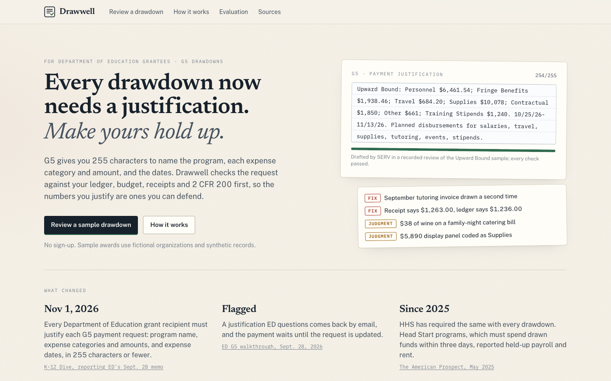
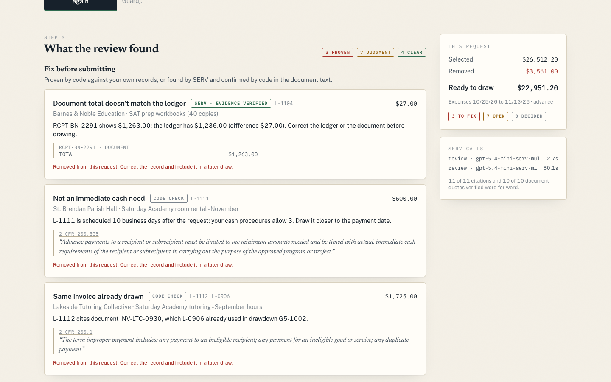
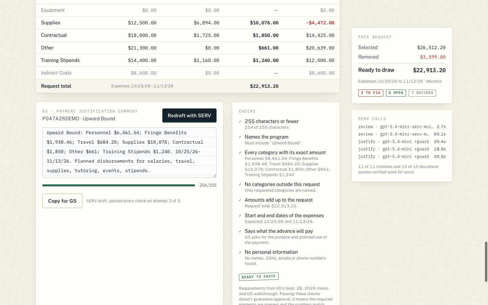
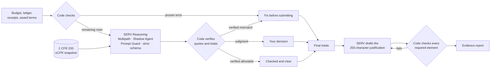

<div align="center">


# Drawwell

**Prepare a Department of Education drawdown you can defend, line by line.**

### Since November 1, every Education Department grantee must justify each drawdown in 255 characters.
**Drawwell checks the draw before you write it: code proves the errors, SERV Reasoning applies the federal cost rules to every line, and you make the judgment calls.**

[Live site](https://drawwell.vercel.app) · [Demo video](https://youtu.be/keEElunJfV0) · [For judges](JUDGES.md) · [How it works](#how-it-works) · [Evaluation](#proven-on-a-frozen-benchmark) · [Checked and attacked](docs/threat-model.md)

[](https://github.com/Femtech-web/drawwell/actions/workflows/ci.yml)
[](LICENSE)


**OpenServ SERV Hackathon Edition 02 · Open Track**



</div>

On **September 28, 2026** the Department of Education told every grant recipient that, starting **November 1**, each G5 payment request needs a written justification of **255 characters or fewer** naming the program, the expense categories and amounts, and the start and end dates of the expenses, "clear without additional narrative" ([K-12 Dive](https://www.k12dive.com/news/education-department-wants-grantees-to-defend-the-spend-DOGE/831743/), [ED's G5 walkthrough](https://www.ed.gov/media/document/g5-grantee-dashboard-submitting-payments-requests-and-payment-justifications-september-28-2026-114638.pdf)). A justification ED questions comes back by email, and the payment waits until it is fixed.

This is not hypothetical. HHS has required a justification with every drawdown since March 2025 ([DOL TEGL 06-25](https://www.dol.gov/sites/dolgov/files/ETA/advisories/TEGL/2025/TEGL%2006-25/TEGL%2006-25.pdf)); Head Start programs, which must spend drawn funds within three days, reported held-up payroll and rent, and one director shut his program temporarily ([The American Prospect](https://prospect.org/2025/05/07/2025-05-07-congress-funded-head-start-trump-administration-holding-up-money/)). The universities' association estimates the federal version cost recipients and agencies about 53,749 hours of duplicated work ([COGR](https://www.cogr.edu/sites/default/files/FINAL%20Infographic%20and%20Appendix.pdf)), and school administrators warn of delays and cash-flow gaps ([AASA via AESA](https://www.aesa.us/2026/10/06/new-defend-the-spend-requirements-could-create-delays-and-administrative-burden-for-districts/)).

Writing 255 characters is the easy part. The hard part is that the numbers in it must be ones you can defend: no invoice drawn twice, nothing outside the budget period, nothing your award doesn't allow, receipts that match the ledger. In a small grantee that check is one person with a spreadsheet, every two weeks. **Drawwell is for that person**: the finance lead behind a TRIO program, a community school partnership or a charter network.

1. **Code proves what can be proven** against your own records: invoices already drawn, the same invoice twice, costs outside the budget period, unpaid costs on a reimbursement award, advances drawn before the cash is needed, categories over the approved budget, items above the equipment threshold, text in a record that is addressed to an AI.
2. **SERV Reasoning applies the rules to every remaining line.** One live call reads each expense with its receipt (PDF or text), your award terms and the text of 2 CFR 200, and decides whether the coded ED 524 budget category fits, whether the cost is allowable or needs judgment, what the receipt actually totals, and which line inside a larger charge is unallowable.
3. **Code verifies SERV's evidence.** A citation is kept only if its quote appears word for word in the dated eCFR text or the award term. A receipt total counts only if the quoted line is in the document and shows that amount. A conclusion that loses its citations falls back to review.
4. **You make the judgment calls.** Costs that depend on an exception, prior approval or your award are never marked unallowable automatically. Remove the wine from a catering bill, exclude a row, or keep it after checking.
5. **SERV writes the justification** from the final, code-computed totals; code checks every required element, and the evidence report traces each dollar for ED's follow-up email.
6. **States check the whole queue.** Federal education money reaches districts through the state, so states see every district's justification first. The reviewer view checks a queue of them against ED's required elements, in the browser.

This is the rule that keeps the model honest ([`src/engine/verify.ts`](src/engine/verify.ts)):

```ts
for (const c of entry.citations) {
  const section = getSection(c.section);
  // kept only if the quote is in the dated eCFR snapshot, word for word
  if (section && quoteAppearsIn(c.quote, sectionText(section))) citations.push(/* … */);
  else rejected++;
}
let allowability = entry.allowability;
if (allowability === "likely_unallowable" && !hasCfr) allowability = "needs_review"; // no rule, no rejection
if (allowability === "allowable" && citations.length === 0) allowability = "needs_review"; // no basis, no approval
```

Drawwell prepares a request. It does not submit to G5, approve payments or give legal advice; the Department decides.

## Who uses it, and who pays

- **Small grantees** (TRIO programs, community school partnerships, charter networks, adult education providers): one finance person drawing federal cash every two weeks. A subscription per award, priced below an hour of a consultant's time a month.
- **Fiscal sponsors and grant consultants:** one office drawing for dozens of awards; per-seat pricing, with evidence reports to hand each client and auditor.
- **State education agencies:** federal education money reaches districts through states, so states now review district justifications before ED does. The [reviewer view](#try-it) checks a whole queue of district justifications against ED's required elements, in the browser; licensed per state.

The same check applies wherever an agency asks recipients to justify each drawdown: HHS has since 2025, and NASA, NIH and the Department of Labor have their own versions. Department of Education first.

## The one moment

The Upward Bound sample draws its November cash needs in advance: twelve ledger rows, $26,512.20. One review, one live SERV call ([recorded run](docs/results/runs/)), and Drawwell finds:

| Row | What | Found by | Outcome |
|---|---|---|---|
| L-1112 | September's tutoring invoice, drawn again | Code: same document and amount as a row already drawn in G5-1002 | Removed, cites the duplicate-payment definition in 2 CFR 200.1 |
| L-1111 | Room rental paid 10 business days out | Code: outside the recipient's 3-day disbursement window | Removed, cites 2 CFR 200.305(b)(1) |
| L-1104 | SAT workbooks: ledger $1,236.00 | SERV read the receipt ($1,263.00); code found the quoted line in it | Removed until the ledger is corrected |
| L-1105 | Family-night catering, $412.60 | SERV isolated "House red wine (2 btl) … 38.00" | Remove $38.00 (2 CFR 200.423); the food is in the award (term T-2) |
| L-1110 | $5,890 display panel coded Supplies | Code: above the $5,000 threshold; SERV: one item, 7-year life, no equipment in the award | Your judgment: prior approval needed (T-3) |
| L-1108 | Business-class airfare | SERV: 200.475(e) has exceptions the record doesn't rule out | Your judgment, not a rejection |
| L-1106 | Staff appreciation lunch | SERV, with verified citations | Your judgment: likely unallowable |

Every citation in that run, 11 of 11, and every award-term quote, 4 of 4, was found word for word in its source. Then the budget table shows Supplies over its approved line, SERV drafts the 255-character justification from what remains, and the checks turn green.

| What the review found | The justification, checked |
|---|---|
|  |  |

The [evidence report](docs/assets/evidence-report.png) from the same run traces every dollar to its row, document, rule and decision, and lists each SERV call: the first came back empty in 2.7 s, the retry without Prompt Guard answered in 60 s.

## Try it

**Live site:** https://drawwell.vercel.app · **Demo video:** https://youtu.be/keEElunJfV0

1. Open **Review a drawdown** and pick **Upward Bound · November advance** (fictional organization, synthetic records, award number `P047A26DEMO`).
2. Open any row to read its receipt, then **Run the review**. It is one live SERV call; the sidebar shows the model, the SERV features, the time and how many citations were verified.
3. Decide the judgment items, then **Draft with SERV** in Step 4 and watch the checks. Edit a number in the comment box and see the check fail.
4. **Open evidence report**: the request, the justification, the line-by-line trace, every decision and every SERV call. Print it or download the JSON.

The other samples: **Full-Service Community Schools** (reimbursement: an unpaid cost, a cost from before the budget period, lobbying, gift cards the award doesn't include) and **Talent Search** (a clean request except one receipt with instructions aimed at AI reviewers). **For state reviewers** (`/reviewer`): load a CSV of district submissions (grantee, program, award number, amount, justification) and see which have every element ED requires and which need follow-up, with the exact gap for each; the sample queue has eight fictional districts. It runs entirely in the browser and needs no SERV call.

**Use your own files** takes a budget CSV and a ledger CSV ([templates](public/templates/)), with receipts and award terms optional. Receipts can be **PDFs** (read as text on the server, then held to the same word-for-word checks) or text files; try the sample's receipts as [PDFs](public/templates/receipts-pdf.zip). Malformed files get line-numbered errors before anything is sent.

## How it works



| Part | Job | Code |
|---|---|---|
| CSV intake | ED 524 categories, dates, exact cents, line-numbered errors | [`src/engine/csv.ts`](src/engine/csv.ts) |
| Code checks | Duplicates, budget period, payment method, advance window, budget lines, equipment threshold, instructions in data | [`src/engine/checks.ts`](src/engine/checks.ts) |
| SERV review | One call per review; policy in the system prompt, rule text and records as data | [`src/serv/prompts.ts`](src/serv/prompts.ts), [`src/serv/schema.ts`](src/serv/schema.ts) |
| Verification | Citations, award terms, receipt totals, partial lines, downgrades | [`src/engine/verify.ts`](src/engine/verify.ts) |
| Justification | Drafted by SERV, checked by code, up to three attempts, plain fallback | [`src/engine/justification.ts`](src/engine/justification.ts), [`src/engine/review.ts`](src/engine/review.ts) |
| Rules | 25 sections of 2 CFR 200 from the eCFR API, dated; ED guidance with provenance | [`src/rules/`](src/rules/), [`scripts/rules/fetch-ecfr.ts`](scripts/rules/fetch-ecfr.ts) |

## How SERV Reasoning is used

Every review is a live call to SERV's OpenAI-compatible endpoint (`inference-api.openserv.ai`), and every justification at least one more. SERV is what reads the receipts and applies the cost principles; without it, Drawwell is the code checks alone (the first column of the benchmark).

| SERV capability | How Drawwell uses it | See it |
|---|---|---|
| **Structured reasoning** (every call) | Applies 25 sections of 2 CFR 200 and the award's terms to each expense, reconciles each receipt with its ledger row, isolates unallowable lines | Sidebar during a review; [recorded runs](docs/results/runs/) |
| **Multipath** (`-serv-multipath`) | The cost principles are a policy matrix: unallowable unless an exception applies, the award includes it, or prior approval exists | Model ID in the sidebar and the evidence report |
| **Shadow Agent** (`serv_shadow_agent`) | Validates SERV's draft against a testable hint before it answers: every row once, quotes word for word, no rejection when the cited rule has an exception | [`REVIEW_SHADOW_HINT`](src/serv/prompts.ts) |
| **Prompt Guard** (`serv_prompt_guard`) | Receipts and ledger descriptions are third-party text | Talent Search sample |
| **Strict JSON schema** | Row IDs, ED 524 categories and CFR sections are enums built from the request, so SERV can only answer about what exists | [`src/serv/schema.ts`](src/serv/schema.ts) |

Rule text travels in the user message as data, not in the system prompt, so Multipath's rewrite of the instructions cannot paraphrase the regulation SERV must quote. Every feature combination was tested against the live API before use ([`docs/results/serv-smoke-gpt-5.4-mini.json`](docs/results/serv-smoke-gpt-5.4-mini.json)). **What we hit live:** full features were the most accurate configuration on the benchmark but slow (one request took 296 s) and sometimes answered HTTP 200 with empty content; parallel runs got HTTP 400. So each review tries full features for up to 150 s, then without Prompt Guard for up to 90 s, then the measured features-off configuration (about 10 s), and records every attempt with the features it used. A review always ends inside the route's 300 s.

## Proven on a frozen benchmark

Four synthetic drawdown requests, **37 labeled expense rows** ([`fixtures/benchmark/labels.json`](fixtures/benchmark/labels.json)): duplicates, budget overruns, out-of-period costs, receipts that disagree with the ledger, alcohol inside catering and hotel bills, costs that depend on award terms, an invented citation and planted instructions. Labels were written from the rule text and award terms before any SERV run; the Charter Schools Program request was **held out** of prompt development. Graded in code; every run is kept, failures included ([`docs/results/`](docs/results/)).

<!-- results-table -->
| | Code rules only | One plain SERV call (gpt-5.4-mini) | Drawwell, SERV features off (gpt-5.4-mini) | Drawwell (gpt-5.4-mini) |
|---|---|---|---|---|
| Defensible allowability | 30/37 | 31/37 | 36/37 | 37/37 |
| Unanswered rows | 0 | 0 | 0 | 0 |
| Unsafe misses (lower is better) | 4 | 0 | 0 | 0 |
| Over-calls (lower is better) | 3 | 3 | 0 | 0 |
| Held-out request | 10/12 | 11/12 | 11/12 | 12/12 |
| Budget category | 34/36 | 32/36 | 36/36 | 36/36 |
| Receipt mismatches found | 2/2 | 2/2 | 2/2 | 2/2 |
| False receipt mismatches | 5 | 4 | 0 | 0 |
| Unallowable lines isolated (exact cents) | 0/3 | 0/3 | 2/3 | 3/3 |
| False partial removals | 0 | 12 | 0 | 1 |
| Planted instructions flagged | 2/2 | 2/2 | 2/2 | 2/2 |
| Citations kept word for word | n/a | 82 unchecked | 67/72 | 47/48 |
| Time for 4 requests | 0s | 51s | 36s | 445s |
| Estimated cost | $0.000 | $0.053 | $0.091 | $0.091 |

Runs: `2026-11-15T06-20-48-564Z-code-only-gpt-5.4-mini.json`, `2026-11-15T20-00-57-588Z-single-call-gpt-5.4-mini.json`, `2026-11-15T21-09-26-630Z-drawwell-plain-gpt-5.4-mini.json`, `2026-11-15T21-16-52-662Z-drawwell-gpt-5.4-mini.json`
<!-- /results-table -->

- **Code rules only:** Drawwell's code checks plus a generic red-flag keyword list. **One plain SERV call:** a minimal prompt with the documents, no rule text, no award terms, no verification, the way most apps add AI. **Drawwell, SERV features off:** the full Drawwell prompt and verification on the base model. **Drawwell:** what ships.
- **Unsafe misses** (an unallowable cost called allowable) and **over-calls** (a cost an exception allows called unallowable) are the strict signals; "defensible" accepts every answer a careful reviewer could give.
- **Cost** is estimated from returned token counts at SERV's published prices, and billing matched: after the starting $1 credit ran out during development, the benchmarks and every end-to-end and live check that followed used about $1 of a $5 top-up (roughly $0.07 per review).
- Read with care: 37 rows is small; the builder wrote the labels; three of four requests were seen while writing prompts; the keyword baseline was written after the demo rows existed.

## Checked and attacked

- **[Guarantees, attacks and what you still trust](docs/threat-model.md):** ten guarantees, each with the test that holds it; fourteen attacks and failure modes, from instructions hidden in a receipt to an exhausted SERV balance, and what happens in each.
- **43 engine tests** (`pnpm test`, no key needed): CSV parsing, exact-cent money, business days, every code check on every sample, the justification checks (ED's required elements; HHS's "payroll" example fails four), and SERV-output verification with fabricated responses: invented citations dropped, unverified totals ignored, shared payroll registers accepted, no model-only blocking error, and the empty-response fallback with a mocked SERV.
- **Three bugs found by live runs and fixed:** payroll registers that support two rows were flagged as receipt mismatches; a catering row was rejected whole after its wine line was already split out; empty SERV responses failed the review. Each has a test now.
- **CI** runs the tests, lint and a production build on every push, with a gitleaks secret scan and a check that no `.env` file is tracked.

## What you still trust

SERV and its upstream model see the rows and documents sent for review (Drawwell stores nothing). The rule snapshot is the 2 CFR 200 sections drawdowns most often touch, not program statutes or your Grant Award Notification; paste those as award terms. ED's exact wording comes from its walkthrough and the memo as reported; [`src/rules/guidance.ts`](src/rules/guidance.ts) marks which lines are verbatim. Code proves consistency with your records, not that your records are true. Details: [threat model](docs/threat-model.md#what-you-still-trust).

## Run it from source

```bash
pnpm install
pnpm test                       # 43 engine tests, no key needed
cp .env.example .env            # add SERV_API_KEY from console.openserv.ai
pnpm dev                        # http://localhost:3000
pnpm smoke                      # live SERV feature combinations
pnpm bench drawwell gpt-5.4-mini   # one benchmark configuration (run them one at a time)
pnpm rules                      # refresh the 2 CFR 200 snapshot from the eCFR API
```

`make test`, `make dev`, `make bench` and friends do the same. Node 22, pnpm 10.

## Deployment

A Next.js 16 app with no database: Vercel (or any Node host) with one secret, `SERV_API_KEY`. Optional: `SERV_MODEL` (default `gpt-5.4-mini`), `SERV_MULTIPATH`, `SERV_SHADOW`, `SERV_PROMPT_GUARD` (set `0` to turn one off), `REVIEWS_PER_IP_PER_10_MIN` (default 8) and `DAILY_SERV_CALL_CAP` (default 150) to protect the credit balance. The review route allows 300 seconds; a review takes about a minute. `pnpm build` bundles the samples and the latest results before `next build`.

## Limits

1. **Department of Education G5 only.** HHS (PMS), NASA, NIH and DOL have their own justification fields and limits; not built.
2. **A subset of the rules.** 25 sections of 2 CFR 200. EDGAR program regulations and program statutes are not loaded unless supplied as award terms.
3. **Synthetic records.** The samples and benchmark are fictional organizations with records we wrote; no real grantee has used it yet.
4. **Text-based receipts.** PDFs with a text layer and text files are read; scanned or photographed receipts are not (the reader says so per file). SERV's documentation does not cover image input.
5. **A small benchmark.** 37 labeled rows, labeled by the builder.
6. **SERV speed and reliability.** With all features on a review usually takes about a minute and occasionally several; empty responses happen. The fallback keeps reviews inside 300 s, at the cost of answering from the features-off configuration when it triggers.
7. **No USAspending lookup.** The approved budget and draw history come from your files; public award data was left out so it cannot block a review.

## Roadmap

| When | What |
|---|---|
| Next | **Scanned and photographed receipts:** OCR before review, with the same quote verification PDFs get today. |
| Next | **HHS Payment Management System profile:** its field length and its "Defend the Spend" guidance, for Head Start and community health grantees. |
| Then | **Draw history from the accounting system:** QuickBooks and Sage Intacct exports mapped to ED 524 categories once, reused every draw. |
| Then | **A reviewer view for state agencies,** which now review district justifications before passing them to ED. |
| Later | **Program packs:** TRIO, 21st CCLC, Title I and IDEA rules loaded as award terms automatically. |

## Hackathon

Built during the SERV Hackathon Edition 02 (November 2026) for the **Open Track**: a new project, started and finished in the build window.

| What | Where |
|---|---|
| SERV Reasoning, every review and justification | [`src/serv/client.ts`](src/serv/client.ts), [`src/engine/review.ts`](src/engine/review.ts) |
| Live feature tests | [`scripts/smoke/serv.ts`](scripts/smoke/serv.ts), [`docs/results/`](docs/results/) |
| PDF receipts, read as text and held to the same checks | [`src/server/pdf.ts`](src/server/pdf.ts), [`src/app/api/extract/route.ts`](src/app/api/extract/route.ts) |
| State reviewer view (queue check, in the browser) | [`src/engine/reviewer.ts`](src/engine/reviewer.ts), [`/reviewer`](https://drawwell.vercel.app/reviewer) |
| Frozen benchmark with baselines and a held-out request | [`scripts/eval/run.ts`](scripts/eval/run.ts), [`fixtures/benchmark/`](fixtures/benchmark/) |

## Repository

```
src/server/          PDF text extraction, request validation, rate limits
src/engine/          code checks, CSV, money, dates, justification checks, SERV-output verification, orchestration
src/serv/            SERV client, prompts, schemas
src/rules/           2 CFR 200 snapshot (eCFR API) and ED guidance with provenance
src/app/             Next.js pages (/, /review, /evaluation, /how-it-works, /sources) and API routes
src/components/      the review workspace, findings, justification and evidence report
fixtures/awards/     the three samples: award, terms, budget, ledger, receipts
fixtures/benchmark/  the held-out request and the frozen labels
scripts/             rules fetch, sample and results bundling, SERV smoke tests, benchmark
tests/               engine unit tests (vitest)
docs/                threat model, screenshots, results of every run
```

## License

[MIT](LICENSE)
